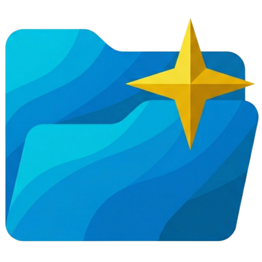

<div align="center">
  
  <h1>FilePilot</h1>
  <p>A local-first Windows file organization workspace</p>
  <p>
    <sub>AI-assisted analysis&nbsp;&nbsp;·&nbsp;&nbsp;Clear plans&nbsp;&nbsp;·&nbsp;&nbsp;Reversible operations</sub>
  </p>
</div>

[简体中文](README.md) | English · [Privacy Policy](PRIVACY.md)

FilePilot is a Windows file organization tool. It uses a model you configure to analyze files and create or carry out an organization plan.

## Choose an organization mode

| Mode | Best for | Flow |
| --- | --- | --- |
| Standard organization | A first-time organization or changing rules for each task | Choose sources → create a plan → review and adjust → pre-check → execute |
| One-click organization | Routine filing with configured classification rules | Choose sources and rules → scan, plan, pre-check, and execute automatically |

Standard organization pauses before execution and shows each file's destination. One-click organization skips the plan confirmation screen; files that do not match a rule or cannot be classified with confidence stay where they are.

## Features

- Move files into existing folders or create a new folder structure.
- Select multiple files and folders as sources for a task.
- Write classification rules for destination folders and reuse them for one-click organization.
- Adjust a standard organization plan and review known execution risks, such as path conflicts and cross-drive moves.
- Keep organization history, review execution records, and attempt to undo the most recent organization.
- Use Icon Studio to create, preview, apply, and restore custom folder icons.

Icon Studio is optional and requires a separately configured image model. File organization only requires a text model.

## Install and get started

The current release is a Windows 10/11 desktop app. Download an installer from [GitHub Releases](https://github.com/qup1010/FilePilot/releases).

On first launch:

1. Open Settings, enter the text model's API endpoint, model name, and API key, then test the connection. The endpoint must be compatible with the OpenAI Chat Completions API.
2. Choose standard or one-click organization from the comparison above.
3. Review the result in Organization History after a task. You can attempt to undo the most recent operation when needed.

### Standard organization

Choose source files or folders, then select **Organize into existing folders** or **Create a new folder structure**. After scanning and plan generation, review each destination and adjust the plan in the workspace if needed. Check the pre-check results before execution.

### One-click organization

Open **Classification Rules** and create a rule set. Add filing instructions for every destination folder. Once the rules are complete, choose a source folder and rule set on the home page and select **One-click organize**. This mode is suited to routine filing in locations such as Downloads or an assets folder, where the classification boundaries are already understood.

For your first run, copy a disposable test folder and confirm that the model output, classification rules, and undo flow behave as expected before organizing important files.

## Models and data

FilePilot does not provide a hosted model service or built-in account. You supply an endpoint compatible with the OpenAI Chat Completions API, such as OpenAI, DeepSeek, Ollama, or another compatible service.

- File scanning, plan review, and file operations run on your computer.
- Analysis and planning may send file names, folder structure, and content excerpts or summaries to the model endpoint you configured. Whether image content is sent depends on whether image understanding is enabled.
- API keys are stored in local configuration and are not submitted to the FilePilot service. Fees, log retention, and data handling for API calls are determined by the model provider.
- Image understanding is off by default. Enabling it or using Icon Studio requires additional image model configuration.

For source development, see [`config.example.json`](./config.example.json) and [`.env.example`](./.env.example). The desktop app can be configured from Settings.

## Current limitations

| Area | Details |
| --- | --- |
| Platform | The current release is for Windows desktop. |
| Scanning | Each task rescans its sources; incremental scanning is not available. |
| One-click organization | A complete classification rule set is required. This mode skips the plan confirmation screen. |
| Pre-checks | Known risks are checked, but not every issue can be detected. Review standard plans before execution; for one-click organization, confirm the rules and source folder first. |
| Undo | Undo applies to the most recent operation. It may be partial if files have since been moved, changed, or locked. |
| Model service | Analysis speed and results depend on model capability, endpoint compatibility, and service availability. |

## Run from source

Requirements:

- Python 3.11+
- Node.js 20+
- An available text model endpoint
- Rust and Windows C++ build tools (only for running or packaging the Tauri desktop shell)

Run the following commands in PowerShell from the project root.

### Install dependencies

```powershell
python -m venv .venv
.venv\Scripts\Activate.ps1
pip install -r requirements.txt

npm --prefix frontend install
npm --prefix desktop install
```

### Run the desktop app

```powershell
npm --prefix desktop run tauri:dev
```

This command starts Tauri, the Next.js frontend, and the local Python backend. The desktop app discovers the backend port at runtime; it does not require port `8765` to be fixed.

### Run only the browser frontend

Open two terminals and run these commands from the project root:

```powershell
python -m file_pilot.api
```

```powershell
npm --prefix frontend run dev
```

In browser mode, the backend must be started separately. The default API address is `http://127.0.0.1:8765`. If that port is occupied, set the same port in both terminals:

```powershell
# Terminal 1
$env:FILE_PILOT_API_PORT = "8766"
python -m file_pilot.api

# Terminal 2
$env:NEXT_PUBLIC_API_BASE_URL = "http://127.0.0.1:8766"
npm --prefix frontend run dev
```

### Where to look if startup fails

- If the desktop app cannot connect to the backend, check whether `output/runtime/backend.json` was created, then inspect `logs/backend/runtime.log`.
- If the one-click button is unavailable, open Classification Rules and add a description for every destination folder in the active rule set.
- If the browser frontend shows a connection error, confirm that the backend is running and that `NEXT_PUBLIC_API_BASE_URL` points to its actual address.

## Project structure

| Directory | Contents |
| --- | --- |
| [`file_pilot/`](./file_pilot/) | Python backend: scanning, model calls, planning, pre-checks, execution, and undo |
| [`frontend/`](./frontend/) | Next.js workspace interface |
| [`desktop/`](./desktop/) | Tauri desktop shell and Windows native capabilities |
| [`tests/`](./tests/) | Python tests |
| [`design-docs/`](./design-docs/) | Feature and architecture design documents |

See the development notes in [frontend/README.md](./frontend/README.md) and [desktop/README.md](./desktop/README.md).

## Common checks

```powershell
python -m unittest discover -s tests -p "test_*.py"
npm --prefix frontend run typecheck
```

For frontend interaction changes, you can also run `npm --prefix frontend test`. For desktop shell changes, run `cargo check` from `desktop/src-tauri`.

## Privacy

See the [Privacy Policy](PRIVACY.md).

## License

[MIT](./LICENSE)
